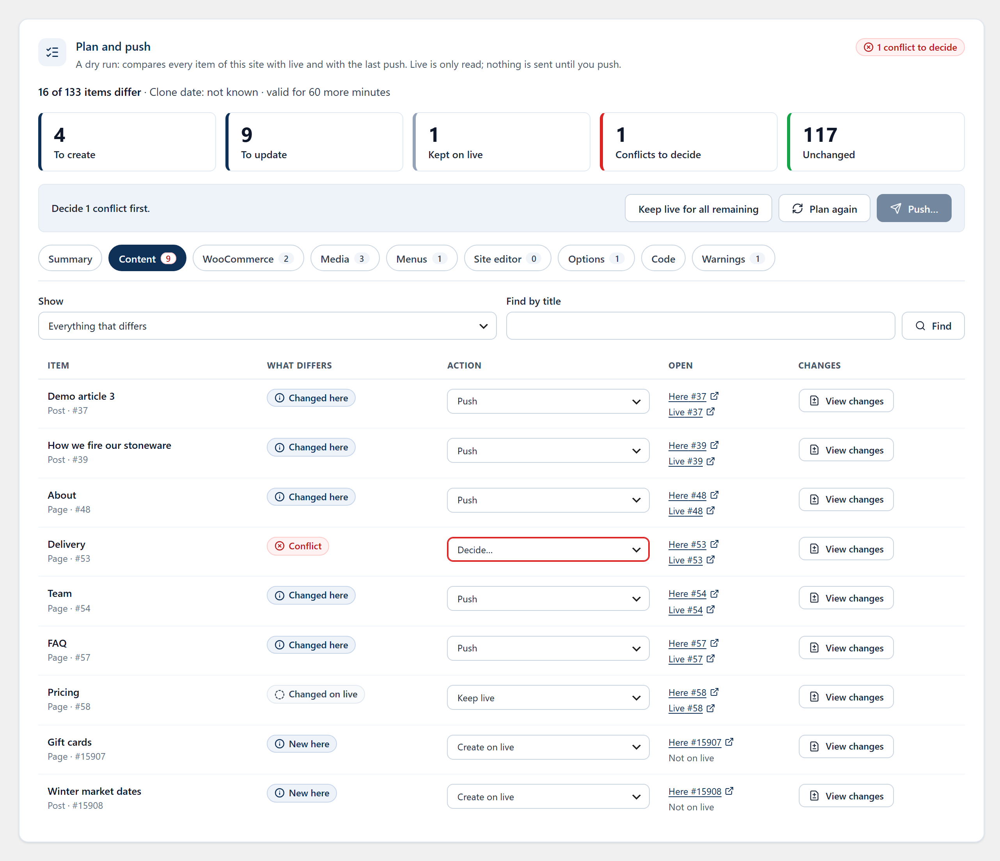
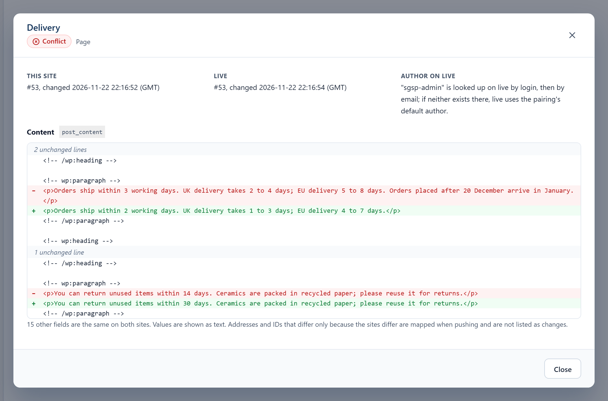
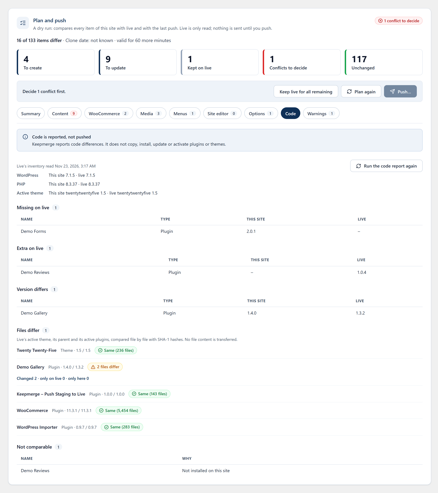
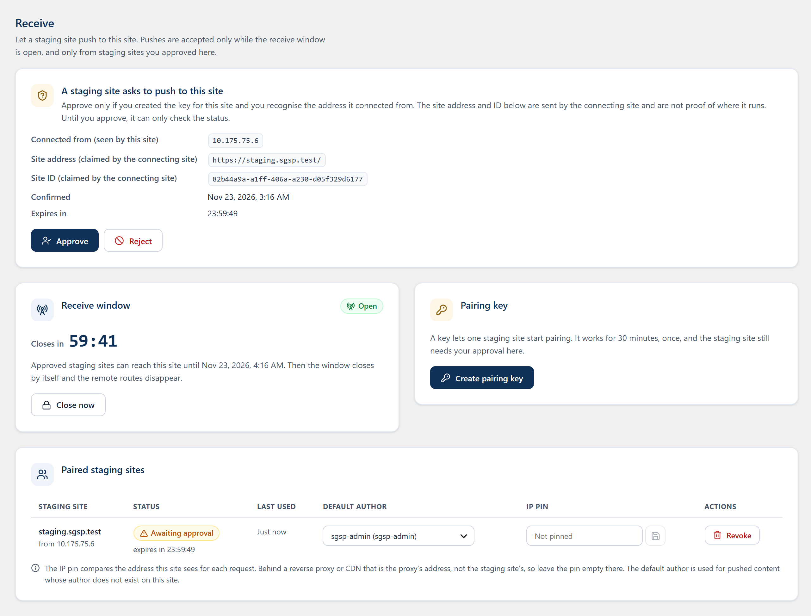
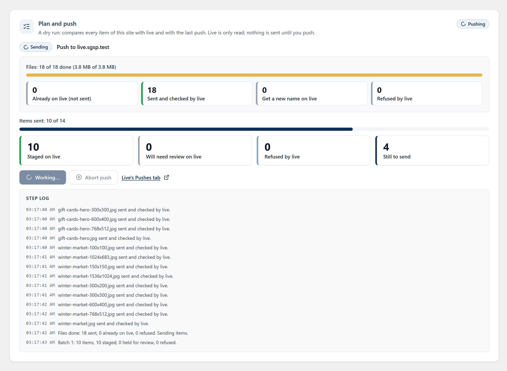
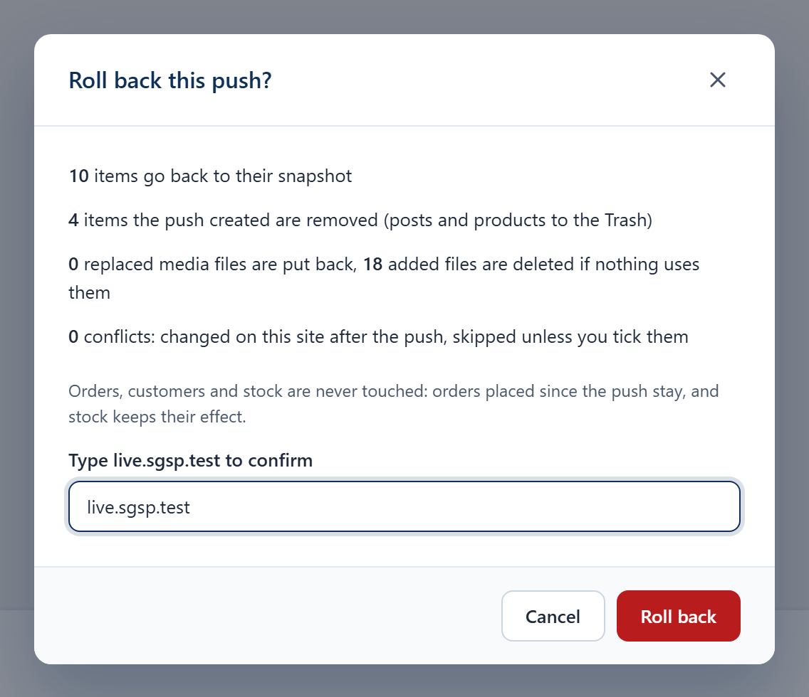

# Keepmerge – Push Staging to Live

A WordPress plugin that pushes content and data from a staging site to its live site, with both sites running the plugin. For every item it compares the staging version, the live version and the version both sites last agreed on: it applies what changed on staging, keeps what changed on live, and lists items changed on both sites as conflicts for you to decide, all in a dry-run diff before anything is written. WooCommerce orders and customers are never read or written, no database table is copied, and theme and plugin code is reported, never pushed.

- Version 1.0.0
- WordPress 6.5 or later (tested up to 7.1), PHP 7.4 or later
- Licence: GPLv2 or later
- Made by [SoftGlaze](https://softglaze.com)

The WordPress.org readme, with the full FAQ, is [keepmerge-push-staging-to-live/readme.txt](keepmerge-push-staging-to-live/readme.txt).

## What it pushes / what it never touches

**Pushed**, after you review the diff:

- Posts, pages and custom post types, including WooCommerce products and variations.
- Categories, tags, product categories, attributes and other public taxonomies.
- Classic menus and their locations.
- Block theme templates, template parts, global styles, patterns and navigation menus stored in the database.
- A list of settings you control (site title, front page, theme customizations, widgets, and any settings you add).
- The images and files those items use, and only those.

**Never moved:**

- Plugin and theme code. Keepmerge lists the differences between the two sites (names, versions and file checksums, never file contents) so you can install or update code on live yourself. It never copies, installs, updates, activates or switches plugins or themes.
- Orders, refunds, subscriptions, coupons, customers and other WooCommerce order and session data.
- Users, roles, comments and reviews.
- Protected settings such as the site address, admin email, active plugins, active theme, user roles and permalinks.
- Data that other plugins keep in their own database tables.

## How it works

1. **Pairing, approved on live.** On live, an administrator opens the receive window and creates a pairing key: one line that works once, for 30 minutes. On staging, the key is pasted under Tools > Staging Push > Send; staging shows the live site's name and address and asks for confirmation. Back on live, the administrator checks the staging site's address, IP address and site ID and clicks Approve. Until then the new pairing can only call the status route.
2. **Receive window.** Live registers its remote REST routes only while the receive window is open. It closes itself after 1 hour by default (8 or 24 hours can be chosen; 24 hours is the maximum). A fresh install registers no remote routes at all.
3. **Application Password and signed requests.** Pairing creates a dedicated receiver user on live with one capability, which cannot log in, cannot use XML-RPC and can reach only Keepmerge's remote routes. Every request from staging carries that user's WordPress Application Password and an HMAC-SHA256 signature over the method, route, query, pairing, site ID, timestamp (within 300 seconds), a one-time nonce and the body hash. Live signs its answers too. The long-term credentials are created during pairing and never shown.
4. **Dry-run diff with conflicts.** Staging exports its items, asks live for its hashes (live is only read), and classifies each item as created, updated, kept as it is on live, or in conflict. Each conflict offers "Keep live" or "Use staging"; the push stays disabled until every conflict is decided, and the push is confirmed by typing the live domain.
5. **Transfer.** Files go first, in chunks checked by SHA-256; only files live is missing or holds with a different checksum are sent. Items are staged on live, not yet applied.
6. **Snapshot before write.** Live saves a snapshot of every item it is about to change, then applies the changes in dependency order. Just before writing each item, live checks it again; an item edited on live after the dry run is skipped and listed.
7. **Held markup, reviewed on live.** Content written by the receiver goes through WordPress's own HTML filter. Items that filter would change (for example a script in a Custom HTML block), custom CSS in global styles and script-like code in page-builder data or settings are held until a live administrator approves, filters or skips each one on live and continues the push there.
8. **Rollback.** A push can be rolled back from live (Tools > Staging Push > Pushes > Roll back) after a preview. Items edited on live after the push are listed and left alone unless you tick them. Snapshots are kept for 30 days and for at least the last three pushes. They cover only what a push changed; keep your host's backups.

## Security model

Keepmerge connects two of your own sites, so it was designed around what could go wrong:

- The live site accepts pushes only while its receive window is open: 1 hour by default, 24 hours at most. While it is closed, the plugin adds no remote REST routes.
- Every request is HTTPS and must pass two checks: the Application Password of a dedicated receiver user that has one capability and cannot log in, and an HMAC-SHA256 signature over the request, a timestamp and a one-time nonce. A replayed or altered request is refused.
- The pairing key works once, for 30 minutes, and a new connection does nothing until it is approved on live. Stored secrets are encrypted with a key taken from a `SOFTGLAZE_SP_KEY` constant in `wp-config.php` or, without it, from the WordPress security keys.
- The live site never makes outbound requests. The staging site connects only to the public address it checked for the live site, pinned for the connection. Received files are checked for path, type and checksum before they reach the uploads folder.
- It cannot change plugins, themes, users, roles, orders or protected settings, and received data is typed JSON, never unserialized.
- Live shares its plugin and theme list only if its administrator switches on the code report (off by default).
- Every pairing, failed attempt and push is logged on the site where it happened, and each push can be rolled back.
- What it cannot protect against: someone who takes over the staging site can change live content within these limits. Protect staging like live, and revoke the pairing if in doubt.

How to report a vulnerability, and a longer summary of the design: [SECURITY.md](SECURITY.md).

## Screenshots

<!-- SCREENSHOTS -->
**1. The dry-run diff: what will be created, updated, kept and which items conflict.**



**2. A conflict: the same page changed on staging and on live, with a text comparison.**



**3. The Code tab: plugin and theme differences are reported, never pushed.**



**4. Pairing on live: the receive window, the one-time pairing key and the approval of the new connection.**



**5. A push in progress with per-step progress.**



**6. Rollback preview on live before restoring a push.**


<!-- /SCREENSHOTS -->

## Requirements

- WordPress 6.5 or later and PHP 7.4 or later on both sites. The two sites may run different WordPress, plugin and theme versions.
- Keepmerge 1.0 on both sites.
- HTTPS on both sites. The live site must be reachable at a public address on port 443.
- WordPress Application Passwords available on live, including for the receiver user (some security plugins and hosts switch them off), and the `Authorization` header passed to PHP.
- The PHP cURL extension on the staging site (it keeps each connection on the address that was checked).
- WooCommerce is optional. Its features switch on only when WooCommerce is active; High-Performance Order Storage can be on or off.
- Multisite networks are not supported in 1.0 (network activation is refused).

## Installation

Install the plugin from its ZIP file, `keepmerge-push-staging-to-live.zip`, attached to a release of this repository or built with `tools/build-zip.ps1` (see [Building the plugin ZIP](#building-the-plugin-zip)). The archive that GitHub offers under "Code > Download ZIP" is the development repository, not an installable plugin.

1. Install and activate Keepmerge on your staging site and on your live site (Plugins > Add New Plugin > Upload Plugin).
2. On live, go to Tools > Staging Push > Receive and click "Open receive window". Then click "Create pairing key" and copy the key. It works once, for 30 minutes.
3. On staging, go to Tools > Staging Push > Send, paste the key, click "Check key", check the site name and address shown, and confirm.
4. Back on live, check the address the staging site connected from, shown on the Receive tab, and click "Approve".
5. On staging, run the baseline. If you know the date staging was copied from live, enter it.
6. Create the plan, review the diff, decide any conflicts, and push.

## WP-CLI

`wp keepmerge` runs the same flow from the shell. The commands that connect, approve, revoke, push or roll back ask for confirmation unless you add `--yes`.

| Command | What it does |
|---|---|
| `wp keepmerge status` | Shows this site's ID, the receive window, the pairings that receive on this site and the pairings this site sends through (each checked with one signed status call). |
| `wp keepmerge receive open [--hours=<1-24>]` / `wp keepmerge receive close` | Opens or closes the receive window. It always closes by itself. |
| `wp keepmerge pair-key` | Creates a pairing key and prints it once (the receive window must be open). |
| `wp keepmerge connect "<key>" [--yes]` | On staging: checks the key, shows what it points to, then confirms and finalizes the pairing. |
| `wp keepmerge pair-approve <pairing> [--yes]` | On live: approves a staging site that finished pairing. |
| `wp keepmerge revoke <pairing> [--yes]` | Revokes a pairing. On live it deletes the receiver user, its Application Passwords and the secrets; on staging it forgets the stored credentials. |
| `wp keepmerge plan [--pairing=<uuid>] [--types=<groups>] [--all] [--format=<table\|json>]` | Builds a dry-run plan against live and prints it. Live is only read. |
| `wp keepmerge push [--plan=<id>] [--pairing=<uuid>] [--yes]` | Pushes a plan to live and lets live apply it; stops when live holds items for review. |
| `wp keepmerge pushes [--side=<received\|sent\|all>] [--format=<table\|json\|csv>]` | Lists the pushes this site received and sent, newest first. |
| `wp keepmerge rollback <push-uuid> [--include=<uuids>] [--yes]` | On live: rolls back a received push after showing the preview (run with `--user=<admin>`). |
| `wp keepmerge audit [--since=<YYYY-MM-DD>] [--event=<event>] [--result=<ok\|denied\|error>] [--limit=<n>] [--format=<table\|json\|csv>]` | Prints this site's audit log, newest first. |

`wp help keepmerge <command>` shows every option.

## Development

### Layout

| Path | What it holds |
|---|---|
| `keepmerge-push-staging-to-live/` | The plugin. `keepmerge-push-staging-to-live.php` holds the header, constants, autoloader and bootstrap; `includes/` the PHP classes, one class per file; `src/admin/` the React source of the admin screen; `build/` the compiled admin files that ship. The ZIP leaves out what its `.distignore` lists. |
| `tests/phpunit/` | The PHPUnit suite (WordPress test library, PHPUnit 9.6) and its bootstrap and configuration. |
| `phpunit.xml.dist`, `phpcs.xml.dist` | PHPUnit and PHP_CodeSniffer configuration. |
| `composer.json`, `composer.lock` | Development packages: PHPUnit, the WordPress test library, PHP_CodeSniffer, WordPress Coding Standards, PHPCompatibilityWP. The plugin itself has no PHP dependencies. |
| `tools/build-zip.ps1` | Builds the plugin ZIP. |
| `tools/zip-audit.php` | Audits a built ZIP. |

To run the plugin from a clone, copy or link the `keepmerge-push-staging-to-live/` folder into `wp-content/plugins/`. The compiled admin files in `build/` are committed, so no build step is needed.

### JavaScript

```sh
cd keepmerge-push-staging-to-live
npm ci
npm run lint:js
npm run build    # or: npm run start, to rebuild on change
```

The admin screen is built with `@wordpress/scripts`; React and the `@wordpress/*` packages come from WordPress core at runtime. Commit the rebuilt `build/` together with the source change: CI rebuilds it and fails when the committed files differ. `package-lock.json` is written by npm 11; CI uses Node.js 26.13.1, which ships with npm 11.

### PHP coding standards

```sh
composer install
composer lint     # php -l on every PHP file
composer phpcs    # WordPress, WordPress-Docs and PHPCompatibilityWP (PHP 7.4+), see phpcs.xml.dist
```

PHPCS has to report no errors and no warnings.

### PHPUnit

The suite runs against WordPress core and a MySQL (or MariaDB) database. The test library drops and recreates every `wptests_` table in that database on each run, so use an empty database that holds nothing else.

```sh
mkdir -p /tmp/wordpress
curl -sSfL https://wordpress.org/wordpress-7.1.5.tar.gz | tar -xz --strip-components=1 -C /tmp/wordpress

export WP_CORE_DIR=/tmp/wordpress
export WP_TESTS_DB_NAME=wordpress_test
export WP_TESTS_DB_USER=root
export WP_TESTS_DB_PASSWORD=your-local-password
export WP_TESTS_DB_HOST=127.0.0.1:3306

composer test
composer test -- --group security          # one group
composer test -- --exclude-group large     # skip the 30 MB + 200 MB media transfer test
```

The PHP extensions `mysqli`, `gd`, `curl`, `mbstring` and `sodium` are needed. Test names carry the IDs of the cases they cover (for example `S-xx` security, `F-xx` functional, `RB-xx` rollback, `I-xx` interrupted push, `U-xx` lifecycle).

### Building the plugin ZIP

```sh
powershell -NoProfile -ExecutionPolicy Bypass -File tools/build-zip.ps1 -Version 1.0.0
php tools/zip-audit.php dist/keepmerge-push-staging-to-live.zip
```

The script runs in Windows PowerShell 5.1 and in PowerShell 7 (`pwsh`). It copies the plugin folder without what `.distignore` lists and without development files, rewrites text files with LF line endings and no byte-order mark, refuses to build when the plugin header and `readme.txt` disagree (name, version, licence, requirements), writes `dist/keepmerge-push-staging-to-live.zip` with forward-slash entry names, and unzips it to `dist/unzipped/`. The audit checks the entries again: everything under `keepmerge-push-staging-to-live/`, no dotfiles, tests, development folders, Markdown, configuration, scripts or archives, LF line endings and no byte-order mark, under 10 MB. The ZIP ships `src/` and `package.json`, so the readable source travels with the build.

### Continuous integration

[](https://github.com/softglazee/keepmerge-push-staging-to-live/actions/workflows/ci.yml)

GitHub Actions runs `.github/workflows/ci.yml` on every push to `main`, on every pull request and on demand:

- `php -l` on every PHP file with PHP 7.4, 8.3 and 8.4;
- PHP_CodeSniffer with `phpcs.xml.dist`;
- JavaScript lint and build, and a check that the committed `build/` matches the source;
- the PHPUnit suite on PHP 7.4, 8.3 and 8.4 with WordPress 7.1.5 and MySQL 8.4;
- the ZIP build and its audit, keeping the ZIP as a workflow artifact;
- [Plugin Check](https://wordpress.org/plugins/plugin-check/), through the [plugin-check-action](https://github.com/WordPress/plugin-check-action), on that ZIP: once with the `plugin_repo` category (the prefixing check excluded, as the WordPress.org upload form does), and once with every default check. Any error or warning fails the job.

The actions are pinned to commit SHAs, and Dependabot proposes their updates once a week.

## Privacy and external services

Keepmerge works site to site only. It connects only to another WordPress site that you pair with it yourself, and it does not use any SoftGlaze server or third-party service. A default installation sends nothing, and the receiving site never sends requests to other servers. The data that travels between the two paired sites, and when, is listed under "External services" in [readme.txt](keepmerge-push-staging-to-live/readme.txt). There is no tracking or analytics of any kind; the audit log stays on each site.

## Reporting security issues

Please report security problems privately, as described in [SECURITY.md](SECURITY.md), not in public issues.

## Licence

GPLv2 or later. See [LICENSE](LICENSE). Bundled icons: [Lucide](https://lucide.dev) (ISC licence).

WooCommerce® and its associated designs are trademarks of Automattic Inc. Keepmerge is an independent plugin and is not affiliated with or endorsed by WooCommerce.
